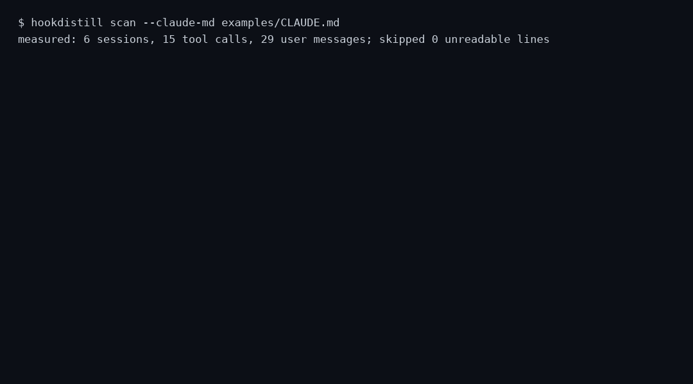

<p align="center">
  
</p>

# hookdistill

**Turn the corrections you keep repeating to Claude Code into hooks, tested against your own history.**

[](https://github.com/abhaythambusiness-tech/hookdistill/actions/workflows/ci.yml)
[](./LICENSE)

You told Claude "don't do that" three times last week, and it did it again today.
A line in `CLAUDE.md` is a request. A hook is a rule it cannot skip. `hookdistill` reads the
sessions already on your disk, finds what you keep correcting, and writes the hook for it. Before
a rule can block anything, it replays the rule against your past sessions so you can see exactly
what it would have caught.

One static Go binary. Runs offline. No model calls, no tokens spent.

## Install

```bash
curl -fsSL https://raw.githubusercontent.com/abhaythambusiness-tech/hookdistill/main/install.sh | sh
```

The script verifies the release checksum before installing to `~/.local/bin` (no `sudo`).
With Go: `go install github.com/abhaythambusiness-tech/hookdistill/cmd/hookdistill@latest`.

## Try it in three commands

```bash
hookdistill scan                  # what do I keep correcting? what does CLAUDE.md cost?
hookdistill propose               # write candidate rules (all start as "warn")
hookdistill replay c-3902ca48     # which past calls would this rule have matched?
```

Happy with the hits? Promote the rule from warning to block, then install the hook once:

```bash
hookdistill promote c-3902ca48    # refuses if you marked any hit as legitimate
hookdistill install               # adds one PreToolUse entry to ~/.claude/settings.json
```

`install` keeps a backup of your settings, changes nothing else in the file, and
`hookdistill uninstall` removes only its own entry.

Try it without touching your data: `examples/` has synthetic sessions and a sample `CLAUDE.md`.

```bash
hookdistill scan --root examples/sessions --claude-md examples/CLAUDE.md
```

## How it works

1. **scan** reads `~/.claude/projects/*/*.jsonl`. A user message that reads like a correction
   ("no, don't...", "I said never...", "ya te dije...") is linked to the tool call right before it.
   An action corrected at least 3 times in at least 2 sessions becomes a candidate.
   It also maps prohibitions in your `CLAUDE.md` that name a command in backticks.
2. **propose** adds candidates to `.claude/hookdistill.rules.json`. Every rule is born as `warn`.
3. **replay** shows every past call a rule would have matched, so you can spot false positives.
4. **promote** turns a rule into `block`, but only if no replayed hit was marked legitimate.
5. **run** is the hook itself. It reads the tool call Claude is about to make and asks or blocks.
   If anything goes wrong it lets the call through: a broken rule never stops your work.

A rule is one JSON object per line:

```json
{"id":"c-3902ca48","event":"PreToolUse","tool":"Bash","pattern":"git\\s+(?:\\S+\\s+)*?commit\\s+(?:\\S+\\s+)*?-am","action":"warn","message":"You corrected this action 5 times (4 sessions). Check before repeating it.","origin":"correction"}
```

## How it compares

Checked on 2026-11-20. Stars change; the approach is what matters.

| Tool | What it does | Looks at your past sessions? | Tests the rule before enforcing it? |
|---|---|---|---|
| **hookdistill** | Mines corrections and `CLAUDE.md`, generates hooks | Yes, all of them | Yes, replay against history |
| [claudecode-rule2hook](https://github.com/zxdxjtu/claudecode-rule2hook) (402 stars) | Converts rule text into hooks | No | No |
| [PRISM](https://github.com/jakeefr/prism) (21 stars) | Analyzes sessions, suggests text edits to `CLAUDE.md` | Yes | No (it recommends text, not hooks) |
| hookify (official plugin) | Rules as markdown; with no arguments, analyzes the recent conversation | Only the current conversation | No |

hookdistill's bet: a rule you can replay is a rule you can trust.

## Limits (v0.1, read these)

- **Heuristics, not magic.** A correction is detected by phrases in English and Spanish.
  Other languages and unusual phrasing are missed; see [CONTRIBUTING](./CONTRIBUTING.md) to add yours.
- **Corrections rarely repeat in exactly the same way.** On the author's own 542 sessions only one
  repeated correction reached the threshold; most useful candidates came from `CLAUDE.md`.
  Expect a short list, not a long one.
- **A "match" is not a mistake.** `scan` reports how many past calls fit a pattern. Use `replay`
  to check they were really mistakes before you block anything.
- **Hooks do not cover everything.** Claude Code may not run them for some subagent, MCP or
  `-p` (non-interactive) cases. Treat a hook as a strong guard, not a guarantee.
- **Costs are labeled.** Token numbers for `CLAUDE.md` are `estimated` (characters / 4), counts of
  sessions and calls are `measured`.
- **The transcript format is undocumented** and can change. The reader skips what it does not
  understand and tells you how many lines it skipped.
- `CLAUDE.md` rules map to `Bash` commands only in v0.1.

## Privacy

Everything runs on your machine. hookdistill makes no network calls and sends nothing anywhere.
Reports redact common secret formats (API keys, tokens) before printing, but redaction is
best-effort: look at a report before you paste it into an issue.

## License

[MIT](./LICENSE). Contributions welcome: see [CONTRIBUTING](./CONTRIBUTING.md).
